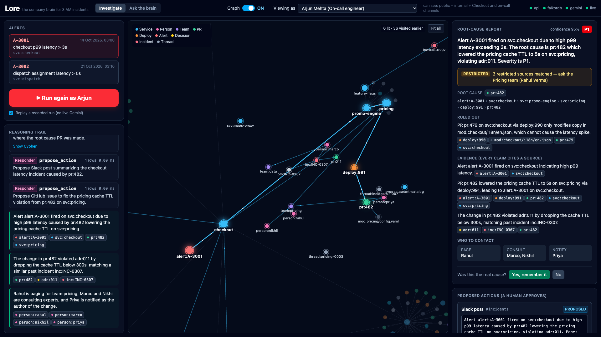
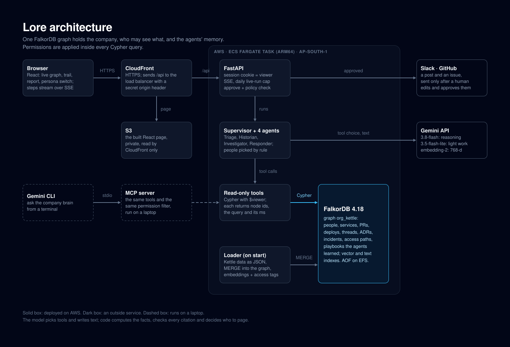
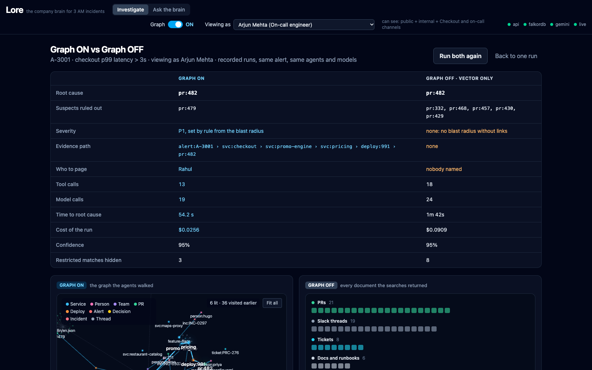

# Lore: the company brain that already knows what broke

Lore loads a fictional food-delivery company ("Kettle") into one **FalkorDB** graph: people, teams, services, PRs, deploys, Slack threads, tickets, design decisions and incidents, plus **who may see what**. When an alert fires, four Gemini agents walk the graph with read-only Cypher tools and write a root-cause report where **every sentence cites a source the viewer is allowed to see**. A human approves anything that leaves the system.

Built solo by Ayan for **Graph Hacks** (WeMakeDevs x FalkorDB), Oct 15-18 2026.

**Why I built it:** my roommate is an on-call engineer and a deep sleeper. One P2 incident pulled in his whole team, principal architects and leads included, and it was later found that it could have been resolved faster if people had the right context. The first person paged is often an SDE-1 who joined a couple of months ago and has no context on the system. Lore tries to bring down the time to RCA for that person, with a human in the loop reviewing and approving everything. The full story, and how I built it with Claude, is in [How I approached it](#how-i-approached-it).

**Live demo:** https://d1cu7fzoa0v5wz.cloudfront.net · **Tracks:** all three · **Video:** see [Live link and video](#live-link-and-video)



Every number in this README comes from a real run or from the eval reports in `backend/eval/`. Kettle is fictional and all data is synthetic; every date in the data is a date in Kettle's story, not a project date.

Jump to: [Quickstart](#quickstart) | [Tracks](#tracks-entered) | [Live link and video](#live-link-and-video) | [Design decisions and Q&A](docs/DESIGN_QA.md) | [AI-assistant disclosure](#ai-assistant-disclosure)

---

## 1. Who is the customer?

Kettle's engineering department: 45 engineers in 6 teams, about 30 microservices. The users are on-call engineers (many joined in the last 6 months), incident commanders, engineering managers and contractors with limited access. Kettle is fictional and all data is synthetic.

Full one-page brief: [docs/discovery-brief.md](docs/discovery-brief.md).

## 2. What was broken?

- It takes a median of **47 minutes** from alert to finding the cause of a serious (P1/P2) incident.
- **3 of the last 10** incidents paged the wrong person first.
- Knowledge is scattered (GitHub, Slack, Jira, ADRs, people's heads), partly restricted, and walks out of the door when people change teams.

## 3. What did you build?

Lore: a permission-aware company graph, four agents (Triage, Historian, Investigator, Responder), answers with sources, and actions behind human approval.

Success targets from the brief: time from alert to cause **under 3 minutes**, **0 permission leaks**, **at least 90%** of statements carrying a valid source, the right owner and expert named the first time. Whether it meets them is in [section 5](#5-how-did-you-evaluate-it).

What it does in the demo (details in [docs/plan.md](docs/plan.md) section 2):

- An alert fires and the agents' steps stream live while the graph lights up.
- A red herring is dismissed; the root cause comes with an evidence path and citations.
- The same question gets a different answer for different people (restricted sources are withheld).
- Lore names who to call; a human edits and approves the Slack post and GitHub issue.
- A post that would leak a restricted source is blocked by a check in code.
- Past investigations become playbooks the next run reuses.

## 4. How does it work?

### Architecture



<details>
<summary>Text version</summary>

```
 Fake company data ("Kettle", a food-delivery startup)
 GitHub PRs · deploys · Slack (public + private channels) · Jira · ADRs · incidents
        │  MERGE loader + Gemini Flash extraction + embeddings + access metadata on every source
        ▼
 ┌────────────────────────── FalkorDB ───────────────────────────┐
 │ graph "org_kettle" = company brain + agent memory + access    │
 │ vector + full-text indexes · algorithms · permission paths    │
 └───────────────────────────────────────────────────────────────┘
        ▲  ~10 read-only Cypher tools, each filtered by the viewer's access
        │  Each returns: data + cypher + ms + node ids (permitted ones only)
        │
 FastAPI (viewer identity from session) ─ Supervisor ─► Triage → Historian → Investigator → Responder
    │  SSE: every step              policy checks in code │ proposals → human edits/approves → Slack, GitHub
    ▼                                                     ▼
 React UI: persona switcher · live graph · trail · cited report      MCP server (same tools) → Gemini CLI

 Eval harness: 50+ golden questions · leak tests · Graph ON vs OFF · latency and cost logs
```

</details>

Three rules carry the design:

1. **Every tool returns the part of the graph it touched** (node ids, the Cypher, the milliseconds). That powers the live animation, the audit trail and the explanation.
2. **Permissions are enforced inside the Cypher query.** Content the viewer may not see never leaves FalkorDB. The viewer comes from the login session, never from the model.
3. **Facts are computed in code; the model narrates.** Gemini picks tools and writes text; every claim must cite an id that a tool returned in this run.

### Who decides what

| The model (Gemini) does | The code does | A human does |
|---|---|---|
| Choose the next tool | Filter by permission inside every query | Approve Slack posts, GitHub issues and rollbacks |
| Read Slack, ticket and ADR text | Compute blast radius, paths, PageRank and expertise scores | Edit a proposed message before it goes out |
| Form and rank hypotheses | Set severity by rule (a tier-1 service in the blast radius means P1) | Confirm or reject the root cause, which feeds memory |
| Write the report and answers, with sources | Check every source link, and check that a post's audience may see every cited source | Request or grant access to restricted sources |
| Summarise an investigation into a playbook | Settle conflicts by source rank (ADR > runbook > ticket > Slack; newer beats older) | |

Deliberately not automated: rollbacks, paging real people, changing permissions, closing incidents, deciding severity.

### Graph data model

One graph per company (`org_kettle`); a second tenant such as `org_demo2` uses FalkorDB's multigraph feature. Every node has a string `id` (`person:arjun`, `svc:pricing`, `pr:482`, `adr:011`).

| Group | Nodes |
|---|---|
| Organisation | Person, Team, Role, Channel (`private: true/false`) |
| Code and services | Service (with `tier`), Repo, CodeModule, PR, Deploy |
| Knowledge | Ticket, Thread (Slack), Doc, Decision (ADR), Incident, Alert, Chunk (text + embedding) |
| Memory and trace | Investigation, Step, Finding, Playbook, Agent, Action, Query |

Main relationships:

- Organisation: `MEMBER_OF`, `OWNS`, `HAS_ROLE`, `IN_CHANNEL`. Leaving a team turns `MEMBER_OF` into `WAS_MEMBER_OF {from, to}`, so an access edge always means current access.
- Access: `VISIBLE_TO` (from a restricted source to the Team, Role or Channel allowed to see it).
- Services and code: `DEPENDS_ON`, `BUILT_FROM`, `CONTAINS`.
- Changes: `AUTHORED`, `REVIEWED`, `MODIFIES`, `IN_REPO`, `DEPLOYED_TO`, `INCLUDES`, `FIXES`.
- Discussions and decisions: `MENTIONS`, `POSTED_IN`, `IMPLEMENTS`, `DISCUSSED_IN`, `RECORDED_IN`, `SUPERSEDES`.
- Incidents: `FIRED_ON`, `AFFECTED`, `CAUSED_BY`, `RESOLVED_BY`.
- Learned: `EXPERT_IN {score, valid_from, valid_to}`, `PART_OF` (Chunk to its source).

Every source node and Chunk carries `source`, `team`, `service`, `updated_at` (Unix seconds) and `access_level`: `public`, `internal`, `restricted` or `confidential`.

**The permission rule.** A viewer can see a source if its access level is open to them, or if there is a *current* path viewer -> Team/Role/Channel <- `VISIBLE_TO` <- source. In Cypher, inside every content-returning query:

```cypher
MATCH (viewer:Person {id: $viewer})
...
WHERE src.access_level IN $open_levels
   OR (viewer)-[:MEMBER_OF|HAS_ROLE|IN_CHANNEL]->()<-[:VISIBLE_TO]-(src)
```

Demo personas: Arjun (on-call engineer, sees public + internal + his own channels), Dana (incident commander with the security role), Sam (contractor, public only), Marco (moved from Pricing to Data, lost access to `#pricing-private`).

Full schema: [docs/plan.md](docs/plan.md) section 5, story: [docs/story-bible.md](docs/story-bible.md).

### Documented Cypher

Every query the agents, the API and the memory module run lives in its own file in **[backend/lore/queries/](backend/lore/queries/)** (42 `*.cypher` files). Each starts with a comment saying what it does, why, and its parameters. The loader's bulk `MERGE` statements and the index setup are in [`backend/lore/loader/`](backend/lore/loader/).

The ones that carry the demo:

| Query | What it does | FalkorDB feature |
|---|---|---|
| [`recent_changes`](backend/lore/queries/recent_changes.cypher) | Deploys and PRs in the failing service and everything it depends on (up to 3 hops), with the code modules each PR modified | variable-length `DEPENDS_ON*0..3` |
| [`evidence_path`](backend/lore/queries/evidence_path.cypher) | Shortest chain alert → service → dependency → deploy → PR, over four relationship types | `algo.SPpaths` (falls back to `shortestPath`) |
| [`blast_radius`](backend/lore/queries/blast_radius.cypher) | Which services depend on the failing one (up to 4 hops back), with their tier; severity is set from this by a rule in code | reverse `DEPENDS_ON` traversal |
| [`pagerank_services`](backend/lore/queries/pagerank_services.cypher) | Which services the rest of the company leans on most | `algo.pageRank` |
| [`vector_search_permitted`](backend/lore/queries/vector_search_permitted.cypher) | Search by meaning, keeping only sources the viewer may see | vector index `db.idx.vector.queryNodes` + permission path |
| [`fulltext_search_permitted`](backend/lore/queries/fulltext_search_permitted.cypher) | Keyword search with the same permission rule | full-text index |
| [`trace_decision`](backend/lore/queries/trace_decision.cypher) | From a service or ADR to the decision, the discussion behind it and what it superseded | `IMPLEMENTS`, `DISCUSSED_IN`, `SUPERSEDES` |
| [`who_knows`](backend/lore/queries/who_knows.cypher) | The owner (current `MEMBER_OF` only, so people who moved teams drop out) and hands-on experts, scored from PRs authored and reviewed and incidents resolved | aggregation over `AUTHORED`, `REVIEWED`, `RESOLVED_BY` |
| [`restricted_match_count`](backend/lore/queries/restricted_match_count.cypher) | How many relevant sources the viewer may *not* see, and which team to ask; never their content | the permission test inverted |
| [`memory_*`](backend/lore/queries/) | Investigations, steps, findings and playbooks written back into the graph | episodic and procedural memory |

### Identity, retries and failures

- The session cookie holds only the persona. The server turns it into a `viewer` and merges it into the query parameters *after* the model's arguments, so the model cannot choose who it is.
- Agent tools use read-only queries (`GRAPH.RO_QUERY`). Only the loader and the memory module write.
- Model output is parsed into Pydantic models; bad output gets one retry with the error explained.
- Every claim is checked against the ids returned by tools in the run; uncited claims are retried once, then dropped and flagged.
- Slow tool calls time out and retry with backoff. If Gemini is down, replay mode plays back a recorded run.

### Failure cases

Failures are built in on purpose. The last column says what happened and where it is checked.

| Failure | How it is caused | What Lore does | What happened (evidence) |
|---|---|---|---|
| Out-of-date or conflicting source | Story D: an old wiki says "60 s TTL is fine", ADR-011 says "≥ 300 s" | Rank sources by rule (ADR > runbook > ticket > Slack; `SUPERSEDES` wins), answer from the best one, show both with a "conflict" tag | Unit tests `test_superseded_source_is_tagged_conflict_and_both_are_shown`, `test_supersedes_wins_even_against_a_higher_rank`. Eval: stale-source recall@5 76% with the graph vs 29% without |
| Model returns badly formatted or uncited output | Tests feed broken output | Parse into Pydantic; every claim must cite an id a tool returned in this run; one retry with the problems listed, then invalid claims are dropped and flagged | Tests `test_uncited_claim_gets_one_retry_with_the_problems`, `test_claims_still_invalid_after_retry_are_dropped` |
| A model or tool call fails or times out | Timeouts, 429/5xx from Gemini, an agent raising | Gemini calls time out and retry with backoff (1 s, 2 s, 4 s); a failed tool returns an error step and the run continues with other evidence | Tests `test_supervisor_survives_an_agent_failure`, `test_gemini_does_not_retry_a_bad_request`; `GRAPH.RO_QUERY` runs with a query timeout |
| User lacks permission | Sam (contractor) runs the incident | No PRs or deploys reach him; the report says restricted sources exist and who to ask | Live: Sam gets no root cause, by design. Leak test: 0 restricted ids across 4 personas × 63 probes |
| Request breaks policy | Dana's draft GitHub issue cites the private `#pricing-private` thread, and the repo is public; "roll back prod now" | Blocked in code with the reason; a rollback is only ever a proposal | Live: the issue was blocked with the reason (FIX_LOG F-09); tests `test_blocked_requests`, `test_post_blocked_when_a_member_cannot_see_a_cited_source` |
| Gemini is down or the daily budget is spent | More than 100 live runs in a day, or no key | Replay a recorded run of the same alert, persona and mode, clearly labelled "replay" | The API switches to replay at the daily cap (`daily_live_limit`); Graph OFF never replays a Graph ON recording (test `test_graph_off_replay_never_falls_back_to_a_graph_on_recording`) |

## 5. How did you evaluate it?

A fixed set of 59 golden questions (`backend/eval/golden.jsonl`) across five types (easy lookup, cross-source synthesis, conflicting sources, out-of-date information, should refuse), asked as different personas. Each layer is measured separately. Scoring is deterministic (key facts and source ids present), not an AI judge. Run it with `make eval`; it writes [`backend/eval/report.md`](backend/eval/report.md) and [`report_generation.md`](backend/eval/report_generation.md).

**Graph ON vs Graph OFF.** Graph OFF is the baseline: the same agents and models, but they can only search text by meaning. It still runs on FalkorDB (its vector index), with the same permission check in Cypher, so it measures what the graph's *links* add. Nothing in Lore runs without FalkorDB.

| Layer | Measure | Target | Graph ON | Graph OFF (vector only) |
|---|---|---|---|---|
| Retrieval | Expected sources in the top 5 (recall@5) | high | **75%** | 38% |
| Retrieval | Plain lookups ("who reviewed PR 482?") recall@5 | high | **93%** | 11% |
| Generation (Ask) | Answers with the key facts | high | **71%** | 43% |
| Generation (Ask) | Claims with a valid source | at least 90% | 67% (below target) | 49% |
| Generation (Ask) | Correct refusals on "should refuse" questions | all | 93% | 66% |
| Permissions | Restricted ids returned, 4 personas × 63 probes | **0** | **0** | **0** |
| Investigation, Story A (live, 6 runs as Arjun) | Root cause PR #482; red herring PR #479 rejected | every run | 6/6; 6/6 | see below |
| Investigation, Story A | Time to root cause | under 3 min | 42–54 s (whole run 50–60 s) | 102 s (one recorded run) |
| Investigation, Story A | Cost per run | low | $0.022–0.027 | $0.091 (one recorded run) |

On Story A, Graph OFF also names PR #482, because the PR's own text mentions the cache TTL. But it needs a second Investigator pass, never examines the red herring, and gives no severity, no evidence path and nobody to page. Learned playbooks make the next similar incident cheaper: on Story B the Investigator went from 8 to 4 steps and the time to root cause from 50 s to 39 s. Details and every fix found while testing: [docs/FIX_LOG.md](docs/FIX_LOG.md).



Hand-checked answers: TODO (about 10 checked by hand; record how many matched the automatic score).

## 6. What would you change before real production use?

- Real GitHub, Slack and Jira connections (webhooks, plus backfilling old data) instead of generated data.
- Single sign-on, with permissions copied from the source systems and re-checked regularly, instead of demo personas.
- Remove personal data before it enters the graph.
- Keep audit logs for a set time.
- Run the evals automatically on every change and block merges that add a leak.
- Cost budgets per team and per request.
- Run inside the customer's own private cloud network (VPC), so no data leaves it.

---

# Hackathon requirements

## Quickstart

Needs: [uv](https://docs.astral.sh/uv/), Node 20+, and Docker Desktop (for FalkorDB). A Gemini API key is optional: with `make load-fake` and replay mode you can run without one.

```bash
cp .env.example .env     # then edit it; add LORE_GEMINI_API_KEY if you have one
make setup               # uv sync + npm install
make db                  # FalkorDB in Docker: port 6379, FalkorDB Browser on http://localhost:3000
make gen                 # (optional) regenerate backend/data/*.json; the generated files are committed
make load-fake           # load the Kettle graph with fake embeddings (use `make load` for real ones)
make api                 # API on http://localhost:8000   (terminal 2)
make web                 # web page on http://localhost:5173   (terminal 3)
```

**UI only, no backend:** `make mock` runs the web page on fake data (`VITE_MOCK=1`).

Other commands: `make test` (fast tests), `make test-all`, `make lint`, `make eval`, `make mcp`. `make help` lists everything. Operating notes, deploy steps and troubleshooting: [docs/RUNBOOK.md](docs/RUNBOOK.md).

**No Docker?** `make db-lite` runs a real FalkorDB (the same module, via [FalkorDBLite](https://github.com/FalkorDB/falkordblite)) on port 6390 with no Docker and no Browser UI. Set `LORE_FALKORDB_PORT=6390` in `.env`. The Oct 16 skeleton was verified this way: loader, every tool, the leak tests and an end-to-end Story A run. FalkorDB Cloud also works in principle (set `LORE_FALKORDB_HOST/PORT/PASSWORD`); it is untested.

## Tracks entered

All three tracks.

- **Track 1, Agents that act on connected data:** agents move through service dependencies and code changes, use graph algorithms (PageRank, shortest paths) as tools, propose real actions behind human approval, and expose the same tools over MCP.
- **Track 2, Agent memory and coordination:** agents remember past investigations as episodic steps, expertise scores with validity dates, and learned playbooks, and share one working space inside the graph.
- **Track 3, Company brain:** people, teams, code, Slack, tickets and design decisions live in one graph, and answers cite their sources and respect permissions.

## Live link and video

- Live demo: **https://d1cu7fzoa0v5wz.cloudfront.net** (AWS: CloudFront + S3 for the page, ECS Fargate for the API with FalkorDB beside it on EFS; see [infra/README.md](infra/README.md)). Live runs call Gemini; after 100 live runs in a day the API plays back a recorded run instead, and the UI marks it "REPLAY". Tick "Replay a recorded run" to watch one without using a live run.
- Demo video (about 3 minutes, business problem first, with one failure case): **TODO**
- Blog post: **TODO** (optional side prize)

## Project docs

| File | What |
|---|---|
| [docs/plan.md](docs/plan.md) | The product plan |
| [docs/discovery-brief.md](docs/discovery-brief.md) | The customer and the problem, one page |
| [docs/story-bible.md](docs/story-bible.md) | The fake company; single source for data and evals |
| [docs/RUNBOOK.md](docs/RUNBOOK.md) | How to run, reset, deploy and troubleshoot |
| [docs/PROJECT_CONTEXT.md](docs/PROJECT_CONTEXT.md) | Repo layout, API and module contracts |
| [docs/DESIGN_QA.md](docs/DESIGN_QA.md) | The main design decisions, and answers to the questions a reviewer is likely to ask |
| [docs/DECISIONS.md](docs/DECISIONS.md) | The decision log, with the alternatives rejected |
| [docs/FIX_LOG.md](docs/FIX_LOG.md) | Every bug found in live testing, why it happened, the fix and how it was verified |
| [backend/eval/](backend/eval/) | Golden questions, the eval harness and its reports |
| [infra/README.md](infra/README.md) | The AWS deployment |

## License

[MIT](LICENSE)

## AI-assistant disclosure

Hackathon rules require disclosing AI coding assistants. The story below is in my own words.

**Tools used:** Claude Code (Anthropic) wrote most of the code and docs in this repo: the skeleton on Oct 16, then the fixes, the AWS infrastructure, the UI changes and the docs, as I directed, reviewed and tested them. The UI screens and diagrams were designed with Claude's `/design` skill. Gemini is used at runtime by the product itself (agents, extraction, embeddings) and generated the synthetic Slack, ticket and ADR wording.

**Planning (before Oct 15):** the plan (`docs/plan.md`) was drafted with Claude in planning sessions at Ayan's request: Ayan set the constraints (solo, Python + React + FalkorDB + FastAPI + Gemini, demoable in 4 days, FDE portfolio framing) and asked Claude to propose the project; Claude proposed the domain, the "Lore" concept, the discovery brief numbers, the permission model and the eval design.

**During the hackathon:** the story bible (`docs/story-bible.md`) was drafted by Claude from the plan on Oct 16 and is under Ayan's review.

### How I approached it

I will be honest with my implementation and how i approach of the problem. I am completely new to graphs. I am someone who loved learning the algorithms around Data Structures and earlier this year learnt about them but was limited only to Graphs. I also am working with an NGO in my current organization which has a requirement of Graphs and its implementation in solving for a problem which requires grading an electronics experiment which has jumper wires and that forms a graph netlist. That is making me dive deeper into the entire concept of graph.

Meanwhile i noticed this event on Luma and also happened to sent by my friends. I was quite pessimistic about this hackathon coz am already a bit swamped up with work and the NGO project. But anyways went ahead and decided to plan about it before the hackathon began. I just wanted to learn how falkordb implements graphs for a database and is it really that helpful while building context engines around it. This got me curious and i skimmed through the docs of falkordb and also how graph databases work. In my current org i have been building context management systems for the past 10 months and had a fair idea of the places this kind of a vector search based context engine fails and the tradeoffs. The main thing is that we cannot really derive relationships or like query similar or related connected things as in we cannot infer A caused B and B caused C from a simple vector search. This is something which graph databases solve for and are really good at.

Honestly i did not know what problem to work on for the hackathon so i prompted Claude that these are my understanding and i want to learn about this technology so that next time when i encounter it i will be aware about this. I also wanted to share what i understood from this implementation. Claude went ahead and planned the project for me, proposed that i can implement something for an on call engineer.

My roommate works in a reputed company and he is a deep sleeper. Whenever his pager gets triggered i always complain that bhai uth jaa page hogaya hai....!!! And then he wakes up and has to sit through the incident till everything is in place. One time it was a major one and took the entire team with even the principal architects and leads time to resolve a P2 incident and was later diagnosed that it could have been resolved faster if people had the right context. Getting the context of why an incident happened at a particular time and why it happened is what takes on calls engineers time the most. And mostly its the SDE-1s who are the first point of contact incase of an incident and then it get translated to the upper management and folks who have the most context about the project. But a SDE-1 who joined maybe couple of months in the project has no context or a lot of work experience in the system where the person got paged. This is what my project is trying to solve. Its trying to bring down the time to RCA and always having a human in the loop to always review and approve it in detail. Lore here is an attempt to build that loop.

Claude helped me setup the stage and the initial plan of the project. And then i guided it through the implementation. Making edits to the code it wrote, ensuring it aligns with the rules of reliability, maintainability and scalability and best practices of deployments with proper budgeting alerting and model selection. I architected the solution, guided the implementation by testing it humanly trying to break it noticing the bugs and reporting them to claude to fix. Noticing the design of the codebase suggesting some edits to the best of my knowledge and also like guiding on the infra side of things which i have knowledge about and chose fargate because its cheaper and did not need an ACM endpoint and the load balancer endpoint is enough to serve the application with the db and api on fargate services and the frontend on the s3 cloudfront.

Cypher queries is similar to SQL according to my understand but that is also what claude wrote. I reviewed the models.py file thoroughly. Yeah this has been my approach while using claude. I kept using the /btw feature on claude to ask questions and guide me on tasks. To self evaluate i was a beginner with the graph db, cypher and also the backend designing part. I was mostly reviewing based on the crux of the files handling the infra giving appropriate roles, using the /design skill to generate designs for the UI and also used the remote control feature to guide and read the docs of claude code implementation while travelling coz its the week of navratri at my place.

I also navigated the UI and identified areas of improvement and also how it can be improved and suggested those edits to claude like the comparison of the graph vs non graph mode. Then in the non graph mode the vector dbs should show up instead of the graph. Also the slight glitchy feel which i noticed while navigating the UI etc.

### Where my testing changed the product

These came from me using the app and reporting what was wrong; each fix is logged with how it was verified in [docs/FIX_LOG.md](docs/FIX_LOG.md):

- **F-16:** the Slack message was a wall of raw ids, so it was rebuilt with names, sections and links.
- **F-17:** a recorded run showed a failed tool step on every replay.
- **F-18:** the graph jittered and the camera jumped between steps during a run.
- **F-19:** with Graph OFF the app still showed the graph, so Graph OFF got its own vector-only view and the Graph ON vs OFF comparison.
- The reasoning model was picked by comparing two models on cost, speed and accuracy (FIX_LOG, "Reasoning-model comparison"), and the deployment (Fargate, S3 and CloudFront, budget and daily cap) was my call (docs/DECISIONS.md D-14 to D-18).
